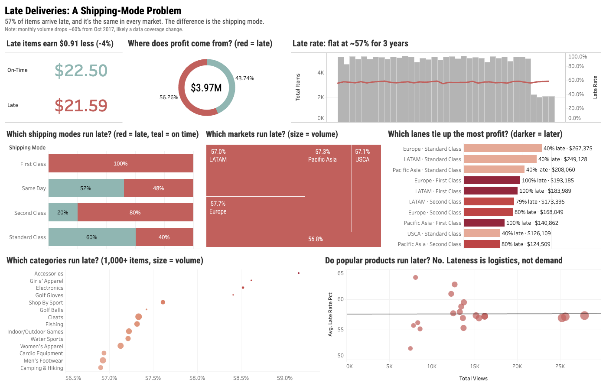

# DataCo Supply Chain: Late Delivery Analysis

An end-to-end analytics project investigating **why 57% of all shipments arrive late** and **what it costs the business**.

**Live Dashboard:** [View on Tableau Public](https://public.tableau.com/views/DataCoLateDeliveryDashboard/Dashboard1?:language=en-US&:sid=&:redirect=auth&:display_count=n&:origin=viz_share_link)

---

## The Business Problem

A global sporting goods retailer ships ~180,000 line items across 5 markets and 4 shipping modes. Management believes late deliveries are a regional issue caused by specific warehouse locations. **This project tests that assumption** and quantifies the financial impact.

## Headline Findings

| Finding | Impact |
|---|---|
| Late deliveries are **structural**, not regional — 57% across all markets and all 37 months | The problem is in the shipping promise, not the geography |
| **First Class is 100% late** (27,814 items) | The SLA is mathematically impossible |
| **Second Class is ~80% late** | Systemic operational failure |
| Late items earn **$0.91 less profit** than on-time items | **$94,094 in lost margin** over 3 years |
| **Demand (page views) does not drive lateness** | The problem is logistics, not warehousing |

## Recommendations

1. **Audit the First Class SLA** — 100% failure means it must be relaxed or the mode discontinued.
2. **Diagnose Second Class** — 80% failure suggests a specific carrier or warehouse is underperforming.
3. **Target Europe & LATAM Standard Class** — $516K of profit is tied up in these two lanes alone.
4. **Investigate high-late categories** — Golf Bags (68.9%), Lacrosse (62.1%), Cameras (62.0%) warrant a category-level audit.

Full narrative: [`docs/findings_and_recommendations.md`](docs/findings_and_recommendations.md)

---

## Project Structure
├── sql/ BigQuery SQL scripts (pipeline in order)
├── docs/ Data dictionary, findings, dashboard images
├── data/processed/ Aggregated CSVs feeding Tableau
├── tableau/ Tableau Public .twbx file
└── README.md

## Tech Stack

| Layer | Tool |
|---|---|
| Data Warehouse | Google BigQuery (free tier) |
| Analysis Language | SQL |
| Visualization | Tableau Public |
| Code Hosting | GitHub (web) |

## How It Was Built

1. **Ingestion** — Two CSVs (~96 MB each) loaded into BigQuery via the Console upload wizard. The orders file required re-encoding from ISO-8859-1 to UTF-8 to preserve accented city names (São Paulo, España).
2. **Cleaning & Features** — `03_cleaning.sql` and `04_features.sql` rename 50+ columns to snake_case, cast zip codes to strings (to preserve leading zeros), and derive an auditable `is_late` flag from `actual_shipping_days > scheduled_shipping_days`. The original `Late_delivery_risk` column was **not** used — we rebuilt lateness independently to prove the flag is correct.
3. **Analysis** — Eight business questions answered in `05_analysis_queries.sql`, from monthly trend to a product-level clickstream join.
4. **Dashboard** — Aggregated CSVs exported and loaded into Tableau Public.

## How to Reproduce

1. Download the three DataCo CSVs from Kaggle.
2. Convert `DataCoSupplyChainDataset.csv` to UTF-8: `iconv -f ISO-8859-1 -t UTF-8 DataCoSupplyChainDataset.csv > orders_utf8.csv`
3. Run the SQL files in `sql/` order (00 → 05) in BigQuery Studio.
4. Export the Q1–Q8 result sets as CSVs into `data/processed/`.
5. Open Tableau Public and connect to the CSVs.

## Data Quality Notes

- **Last ~4 months are partial** — dataset ends mid-Jan 2018; October 2017 onward shows ~60% lower volume.
- **Geographic coordinates** in the source (`Latitude`/`Longitude`) refer to the *store*, not the shipment destination.
- **`Product Status`** is counter-intuitive: `1 = not available`, `0 = available`.
- **Order-level fields** (`Benefit per order`, `Sales per customer`) repeat per line item and are never summed — we use `Order Profit Per Order` at the line-item grain instead.

